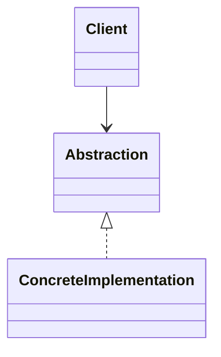

# [Pattern Name]

**Category:** Creational / Structural / Behavioral  
**Status:** Planned / In Progress / Complete

> Replace every placeholder and remove sections that do not apply. Do not mark the example complete until the code, tests, and instructions have been verified.

## Intent

In one or two sentences, explain what the pattern does.

## Problem

Describe the concrete design problem before using the pattern. Include the design pressure that makes the problem worth solving.

## Example Scenario

Explain the scenario in ordinary language. State what the client needs to accomplish and which parts are likely to change.

## When to Use It

- Describe the conditions that make this pattern useful.
- Identify the variation or complexity the pattern isolates.

## When Not to Use It

- Describe when a direct implementation or simpler abstraction is sufficient.
- Identify signs that the pattern would add unnecessary complexity.

## Structure

Describe the participants and their responsibilities.

### Diagram

Add a small class diagram or flow diagram. Keep it consistent with the implementation.

Replace this illustrative diagram with the actual relationships for the selected pattern.

## Implementations

| Level | Scenario | Main learning objective | Status |
|---|---|---|---|
| Beginner | [Small standalone example] | Understand the core intent | Planned |
| Intermediate | [Realistic application example] | Apply the pattern with application boundaries | Planned |
| Advanced | [Harder scenario] | Explore failure modes, trade-offs, or performance where relevant | Planned |

### Beginner

- **Project path:** `src/[Category]/[Pattern]/Beginner/`
- **Run:** `[command]`
- **Test:** `[command]`
- **Expected behavior:** [describe the output or observable result]

### Intermediate

- **Project path:** `src/[Category]/[Pattern]/Intermediate/`
- **Prerequisites:** [list only the services actually required]
- **Run:** `[command]`
- **Test:** `[command]`
- **Expected behavior:** [describe the output or observable result]

### Advanced

- **Project path:** `src/[Category]/[Pattern]/Advanced/`
- **Prerequisites:** [list infrastructure and configuration requirements]
- **Run:** `[command]`
- **Test:** `[command]`
- **Expected behavior:** [describe the output or observable result]

## Execution Flow

Describe what happens at runtime, in order. Explain how the client reaches the relevant abstraction and implementation.

## Why This Pattern?

Explain why the pattern addresses the problem better than the simplest plausible alternative in this particular example. Avoid generic claims such as "it makes the code cleaner" without explaining what becomes easier to change or test.

## Alternatives Considered

| Alternative | Why it might fit | Why it was or was not selected |
|---|---|---|
| Direct implementation | [Benefits] | [Reason] |
| Simpler abstraction | [Benefits] | [Reason] |
| Related pattern | [Benefits] | [Reason] |

## Trade-offs and Limitations

- **Benefits:** [specific benefits]
- **Costs:** [extra types, indirection, configuration, or maintenance]
- **Limitations:** [what the pattern does not solve]
- **Removal criteria:** [when you would simplify or replace the design]

## Testing

List the important behaviors and failure cases covered by tests. Distinguish unit tests from integration tests.

- [ ] Core behavior
- [ ] Important edge cases
- [ ] Failure handling where relevant
- [ ] Integration behavior where relevant

## Key Takeaways

Summarize what this example demonstrates and which design decision the reader should remember.

## References

List relevant books, official documentation, or other sources. Clearly distinguish the original GoF intent from any adaptation made for modern C#/.NET.
