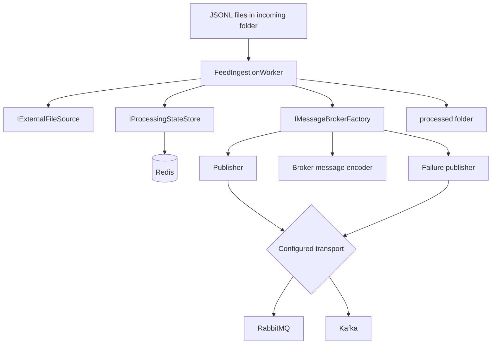

# Abstract Factory — Advanced: External Feed Ingestion Platform

A .NET 10 Worker that reads external JSONL files, validates records, tracks processing state in Redis, and publishes integration events through either RabbitMQ or Kafka. The project demonstrates Abstract Factory by creating a coherent family of broker-specific components.

> Educational reference implementation. It demonstrates **at-least-once** delivery, not exactly-once delivery. Redis and a broker do not share an atomic transaction in this design.

## What it does

1. Polls for `*.jsonl` files through `IExternalFileSource`; the project includes a mounted/drop-folder adapter and an optional SFTP adapter.
2. Processes only files with the final `.jsonl` extension. Producers should upload/copy to a temporary extension such as `.part` and rename atomically to `.jsonl` only when the file is complete.
3. Computes a SHA-256 fingerprint for each file.
4. Uses Redis to acquire a file lease, remember processed records, and mark completed files.
5. Reads the downloaded/local-spooled file as a stream, one JSONL line at a time.
6. Validates each order record and emits `OrderImportedEvent` messages to the configured broker.
7. Publishes invalid records to a failure destination.
8. Archives completed files in the local processed folder or the configured remote SFTP archive folder.

No relational database is used.

## Abstract Factory in this project

`IMessageBrokerFactory` creates three related products:

- `IMessagePublisher`
- `IBrokerMessageEncoder`
- `IFailurePublisher`

`RabbitMqFactory` produces RabbitMQ-oriented products: its encoder chooses a routing key, its publisher sends to a durable topic exchange, and its failure publisher routes to a bound failure queue. The exchange binds `orders.imported` to `feed.orders` and `feed.failures` to `feed.failures` so mandatory publishing has a matching queue.

`KafkaFactory` produces Kafka-oriented products: its encoder chooses a topic, its publisher writes to that topic, and its failure publisher writes to a failure topic.

The Worker depends on the factory and product abstractions. It does not contain RabbitMQ/Kafka `if` statements. Provider selection happens once in `Program.cs` during composition.

This is a meaningful use of Abstract Factory because the selected broker affects a coordinated set of products and destinations. If a future version only needed to swap one publisher and had no related products, a simpler `IMessagePublisher` abstraction could be sufficient.

## Architecture



## Prerequisites

- .NET 10 SDK
- Docker with Docker Compose
- Git (optional)

The project pins package versions in the project file for reproducible restores. Check package updates before using it as a production service.

## Start infrastructure

Start Redis and RabbitMQ for the default provider:

```bash
docker compose up -d redis rabbitmq
```

To use Kafka instead, start Redis and Kafka:

```bash
docker compose up -d redis kafka
```

Services exposed on the host:

| Service | Address | Notes |
|---|---|---|
| Redis | `localhost:6379` | Processing state and idempotency markers |
| RabbitMQ AMQP | `localhost:5672` | Default broker |
| RabbitMQ management UI | http://localhost:15672 | Dev credentials: `guest` / `guest` |
| Kafka | `localhost:9092` | Single-node development setup |

The credentials and topology are for local development only. Do not reuse default credentials in production.

## Run with RabbitMQ

First move into this project's directory inside the main repository:

```bash
cd src/Creational/AbstractFactory/Advanced
```

Then start dependencies, place a sample file atomically, and run the Worker:

```bash
docker compose up -d redis rabbitmq
mkdir -p data/incoming data/processed
cp samples/orders.jsonl data/incoming/orders.jsonl.part
mv data/incoming/orders.jsonl.part data/incoming/orders.jsonl
dotnet restore
dotnet run --project src/FeedIngestion.Worker
```

PowerShell equivalent after changing into the `Advanced` directory:

```powershell
docker compose up -d redis rabbitmq
New-Item -ItemType Directory -Force data/incoming, data/processed | Out-Null
Copy-Item samples/orders.jsonl data/incoming/orders.jsonl.part
Move-Item data/incoming/orders.jsonl.part data/incoming/orders.jsonl
dotnet restore
dotnet run --project src/FeedIngestion.Worker
```

The sample includes valid records and one invalid record. Valid events use the `orders.imported` routing key and land in the durable `feed.orders` queue. Invalid records are sent to the `feed.failures` queue, bound to the `feed.events` topic exchange.

## Run with Kafka

Start Redis and Kafka, then select Kafka in the environment:

First start Kafka and Redis and navigate to the `Advanced` directory as described above:

```bash
docker compose up -d redis kafka
```

**Bash / Linux / macOS**

```bash
Broker__Provider=Kafka dotnet run --project src/FeedIngestion.Worker
```

**PowerShell**

```powershell
$env:Broker__Provider = "Kafka"
dotnet run --project src/FeedIngestion.Worker
```

The worker publishes valid events to the `feed.order-imported` topic and failures to `feed.failures`. Make sure topic auto-creation is enabled or create those topics before running the worker.

## Run tests

Run from this project's `Advanced` directory:

```bash
dotnet test AbstractFactory.Advanced.sln
```

Unit tests cover JSONL record validation and broker-specific encoding without requiring Redis or a live broker. The Redis and broker adapters are infrastructure boundaries; add integration tests against real containers before treating the project as production-ready.

## Redis keys and processing semantics

The store uses keys similar to:

```text
feed:file:{sha256}:completed
feed:file:{sha256}:lease
feed:record:{sha256}:{lineNumber}:processed
```

- A lease prevents two workers from processing the same file at the same time.
- A record marker is written after publishing succeeds.
- Completed-file markers are retained for a configurable period.
- Lease release checks the owner token so one worker cannot release another worker's lease.

### Important delivery trade-off

The event is published **before** the record is marked as processed in Redis. If the broker accepts a message and the worker crashes before Redis records the marker, the event can be published again during recovery. This is intentional at-least-once behavior. Consumers should be idempotent using the stable `EventId`.

The system cannot guarantee atomic exactly-once behavior across Redis and RabbitMQ/Kafka without a stronger coordination design. A transactional outbox is a common alternative when a durable primary database is available.

Identical file contents produce the same SHA-256 fingerprint and are treated as the same import during the marker retention period. If identical content should represent a new business import, add an explicit batch/import ID to the identity scheme.

## Failure handling

- Invalid JSON or invalid field values are published to the broker's failure destination and marked as processed once the failure publish succeeds.
- Infrastructure errors leave the file in the incoming folder. Successfully published earlier records are skipped on the next attempt if their Redis markers exist.
- A publish may be repeated after a crash between broker confirmation and the Redis marker write.
- Failure records include a truncated copy of the raw line for debugging. In production, redact personal or sensitive data before publishing failure payloads.

## Configuration

Configuration is in `src/FeedIngestion.Worker/appsettings.json` and can be overridden with environment variables using `__` as the section separator.

Examples:

```text
Broker__Provider=RabbitMQ
Redis__ConnectionString=localhost:6379
RabbitMq__HostName=localhost
Kafka__BootstrapServers=localhost:9092
Feed__IncomingDirectory=data/incoming
FileSource__Provider=Directory
Sftp__Host=sftp.example.com
Sftp__UserName=feeduser
Sftp__Password=<set-through-a-secret-store>
```

Supported `Broker:Provider` values are `RabbitMQ` and `Kafka`. `FileSource:Provider` can be `Directory` (default) or `Sftp`. Configure SFTP connection details with `Sftp__Host`, `Sftp__UserName`, `Sftp__Password`, `Sftp__IncomingDirectory`, and `Sftp__ProcessedDirectory`. Use environment variables or a secret manager for credentials; do not commit real SFTP passwords.

## External file sources: directory and SFTP

`IExternalFileSource` isolates file listing, opening, and archiving. The included `DirectoryFileSource` gives an easy, reproducible local drop-folder workflow. `SftpExternalFileSource` connects to a configured SFTP server, downloads remote JSONL files into a local spool for hashing/streaming, and renames processed files into the remote archive directory.

To select SFTP, set `FileSource__Provider=Sftp` and configure `Sftp__Host`, `Sftp__Port`, `Sftp__UserName`, `Sftp__Password`, `Sftp__IncomingDirectory`, `Sftp__ProcessedDirectory`, and `Sftp__LocalSpoolDirectory`. Use a real secret store or environment variables for credentials; the placeholder password in `appsettings.json` must be replaced. The remote producer should upload to a temporary suffix and rename to `.jsonl` only after upload is complete. An S3-compatible adapter can follow the same contract.

## Limitations and production hardening

This sample is intentionally small, but the following would be required before production use:

- Add integration tests for Redis lease expiry and broker publishing/confirmation behavior.
- Add retry/backoff policies and explicit handling for permanent broker errors.
- Add metrics, tracing, health checks, and operational dashboards.
- Make lease duration configurable against maximum processing time or implement lease renewal for very large files.
- Decide how poison files and repeated failures are quarantined.
- Redact PII from failure payloads.
- Define broker topology and topic retention through deployment automation.
- Consider a transactional outbox or other durable coordination strategy if losing or duplicating events is unacceptable.

## Related pattern

See the repository-level [Abstract Factory documentation](../README.md) for the pattern structure and the Beginner / Intermediate projects.
