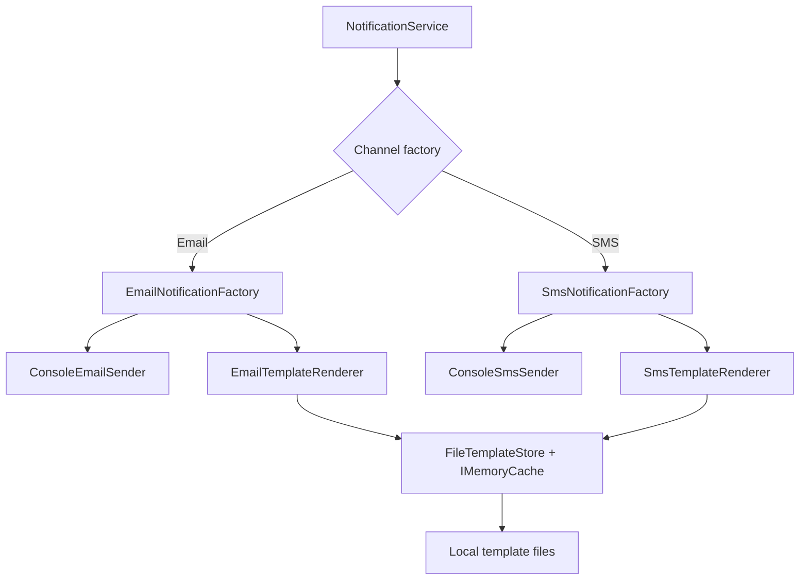

# Abstract Factory — Beginner: Notification Center

A small, runnable C#/.NET example demonstrating the **Abstract Factory** pattern through an email/SMS notification service.

## Problem

The application supports two notification channels: email and SMS. Each channel needs a compatible pair of products:

- a notification sender;
- a template renderer.

The application code should send notifications without directly constructing `EmailSender`, `SmsSender`, or their renderers. Each concrete factory creates products for one channel family.

## Pattern map

| GoF role | Implementation |
|---|---|
| Abstract Factory | `INotificationFactory` |
| Concrete Factories | `EmailNotificationFactory`, `SmsNotificationFactory` |
| Abstract Products | `INotificationSender`, `ITemplateRenderer` |
| Concrete Products | `ConsoleEmailSender`, `ConsoleSmsSender`, `EmailTemplateRenderer`, `SmsTemplateRenderer` |
| Client | `NotificationService` |

`NotificationService` gets the factories through dependency injection and selects one based on the requested channel. The renderers load templates from local files through `FileTemplateStore`, which caches template contents with `IMemoryCache`.

## Requirements

- .NET 10 SDK (LTS)
- Internet access on first build to restore NuGet packages

## Run

From this directory:

```bash
dotnet run --project src/NotificationCenter/NotificationCenter.csproj
```

The app sends one email, sends the same email again to demonstrate a cache hit, and sends one SMS. Sending is simulated by writing to the console; this sample does not call a real email or SMS provider.

## Test

```bash
dotnet test AbstractFactory.Beginner.sln
```

## Expected behavior

- Email values are HTML-encoded before being inserted into an HTML template.
- SMS values are inserted as plain text.
- Template file contents are cached for five minutes.
- The same template requested twice should produce a cache hit on the second request.
- An unknown channel, missing template, invalid template name, or unresolved placeholder should fail explicitly rather than silently producing a misleading notification.

Exact cache counters can vary if you modify the sample or run requests concurrently. In the provided sequential demo, the email template is read once and reused; the SMS template is a separate cache entry.

## Project structure

```text
Beginner/
├── README.md
├── src/NotificationCenter/
│   ├── Abstractions/
│   ├── Application/
│   ├── Domain/
│   ├── Infrastructure/
│   ├── Templates/Email/
│   └── Templates/Sms/
└── tests/NotificationCenter.Tests/
```

## Architecture



## Why Abstract Factory?

The point is not that both products expose the same methods. The sender and renderer have different interfaces. They are grouped because the factory creates a compatible family for one notification channel.

If the application only had one notification channel, this factory hierarchy might be unnecessary. The pattern becomes useful when channel families are a real variation point and client code should not own concrete object creation.

## Deliberate limitations

- Senders are console simulations, not production email/SMS integrations.
- `IMemoryCache` is local to one process and is cleared on restart.
- The sample does not persist notification history or guarantee delivery.
- Factory selection is intentionally simple; a larger system might use configuration validation or a dedicated resolver.
- This is an educational project, not a production notification platform.
